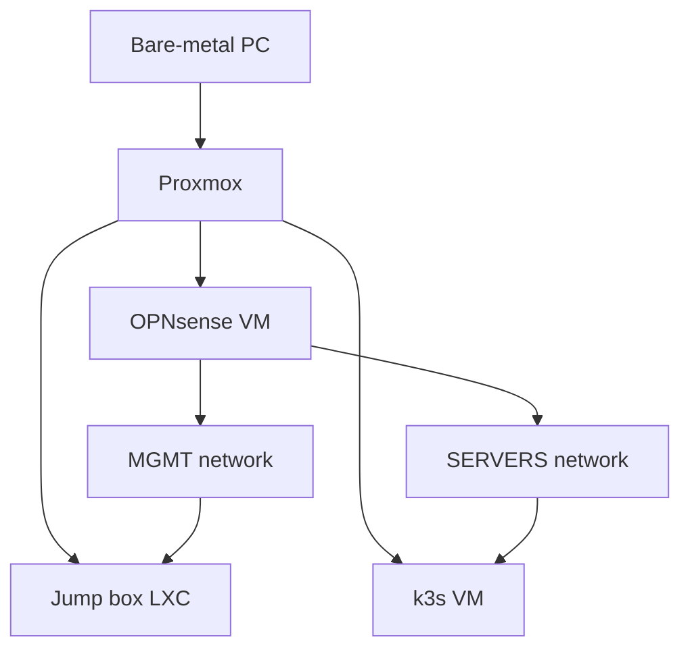

## Overview

This repository is the documentation and source of truth for a self-hosted home lab. It makes the deployed environment understandable, reproducible, and recoverable after configuration loss or a host failure.

The repository contains:

* Infrastructure documentation and architecture decisions
* Proxmox host, virtual machine, and container configuration
* OPNsense firewall and routing configuration
* k3s cluster building blocks and deployed workloads
* Bootstrap, provisioning, and recovery scripts

The repository documents deployed systems only. Missing current details are recorded as open questions and are not filled with assumptions.

## Architecture

The lab runs on one bare-metal PC with Proxmox as the virtualization platform.

OPNsense is the network and security boundary. The jump box provides the management path to the OPNsense web interface. The K3s VM hosts the Kubernetes cluster.

### Network Segments

The network is documented using the network address and the gateway separately. The `.1` address is the intended gateway for each segment.

| Segment | Network        | Gateway       | Status   | Purpose                         |
|---------|----------------|---------------|----------|---------------------------------|
| MGMT    | `10.0.10.0/24` | `10.0.10.1`   | Deployed | OPNsense and bastion management |
| SERVERS | `10.0.30.0/24` | `10.0.30.1`   | Deployed | K3s and deployed server services |

Actual firewall rules, routes, assignments, and service exposure belong in the OPNsense configuration and relevant service documentation.

## Repository Layout

| Directory        | Responsibility                                                   |
|------------------|-----------------------------------------------------------------|
| `docs/`          | Architecture, network design, inventory, operations, recovery, and decisions |
| `proxmox/`       | Proxmox host, VM, LXC, storage, and bootstrap configuration     |
| `opnsense/`      | Firewall, routing, aliases, and redacted configuration exports |
| `k3s/`           | Cluster configuration, infrastructure components, policies, and workloads |
| `scripts/`       | Bootstrap, provisioning, migration, and recovery automation     |

Each directory should contain the deployed configuration for the system it owns. Cross-system dependencies should be documented in `docs/` rather than duplicated in multiple configuration directories.

## Source Of Truth

* Documentation records intent, topology, dependencies, operational procedures, and recovery knowledge.
* Subsystem directories contain the desired configuration for their owning platform.
* Scripts automate repeatable actions that cannot be represented declaratively.
* Device exports, generated manifests, runtime state, and backups are evidence or recovery material, not the authoritative configuration when a source representation exists.
* Secrets, private keys, kubeconfigs, certificates, unredacted exports, and unencrypted backups must remain outside the repository or in an approved encrypted workflow.

## Change Approach

Infrastructure changes should identify the affected system, dependencies, validation check, and rollback or recovery path. Changes to firewall policy, routing, access control, service exposure, or live infrastructure require explicit approval before they are applied.

See [AGENTS.md](AGENTS.md) for the project-wide working and safety guidelines.